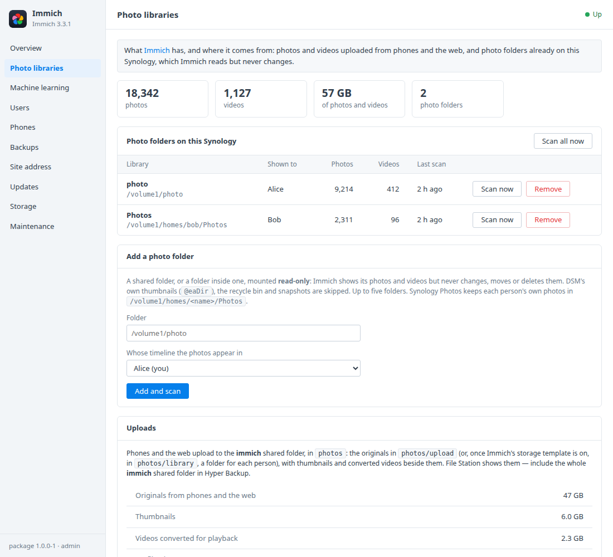
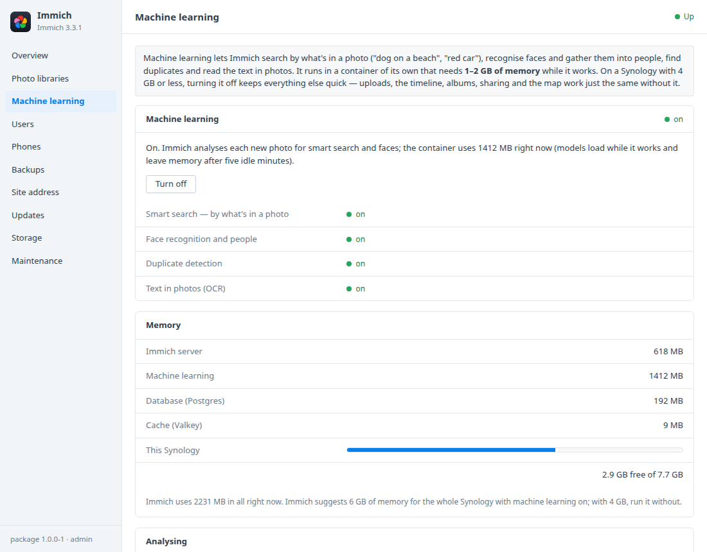
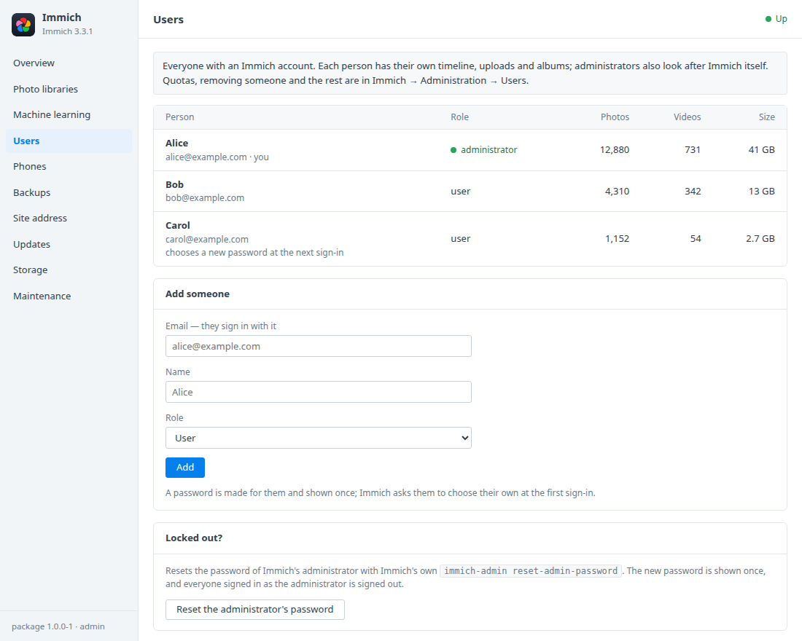
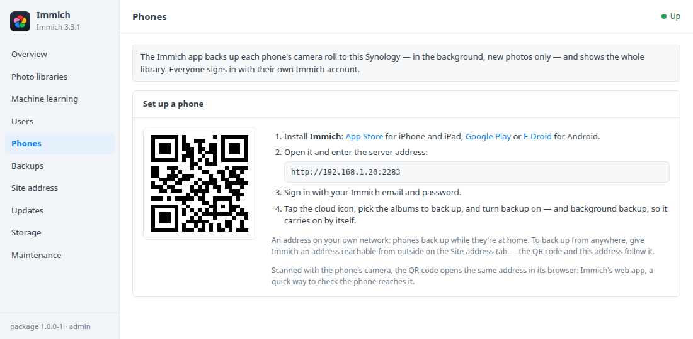

# Immich for Synology DSM

A DSM 7 package that installs [Immich](https://immich.app) in Container
Manager. Immich backs up the photos and videos on your phones to your Synology
and shows the whole library in a fast timeline, with albums, sharing, a map
and memories — and, with machine learning on, search by what's in a photo and
by face. An **Immich** window in DSM covers:
- photo folders already on your Synology, shown read-only;
- machine learning on or off, with what it costs in memory;
- users and the administrator's password;
- setting up phones with a QR code;
- database backups and careful updates.

Built on the [DSM app chassis](https://github.com/tombruton87/dsm-app-chassis).

## Download

### **[⬇ Download immich.spk](https://github.com/tombruton87/immich-dsm/releases/latest/download/immich.spk)**

[](https://github.com/tombruton87/immich-dsm/releases/latest)

That link always gives the newest version. Older ones are on the
[Releases](https://github.com/tombruton87/immich-dsm/releases) page.

Install: Package Center → Manual Install → the `.spk` (DSM 7.2.1+, an x86-64
or ARM64 Synology; Container Manager is installed first if missing). The
wizard asks for:
- the NAS's address;
- a port (2283 by default);
- a time zone;
- your email and name;
- a photo folder to show (optional, usually `/volume1/photo`);
- machine learning on or off (it suggests one from this Synology's memory).

The first start downloads the images (about 3.6 GB once unpacked, and 1.1 GB
more for machine learning, whose models add about 1 GB the first time they're
used) and sets up the database. Your administrator's password is then
shown once in the window.

## Memory

Immich suggests 6 GB of memory for the whole Synology, and 4 GB is enough
without machine learning. Measured on a test box with machine learning off and
a small library: the server about 750 MB once settled (1.3 GB while it
imported the first photos), Postgres 70–550 MB, Valkey about 10 MB. Machine learning adds 1–2 GB while
it works; its models leave memory after five idle minutes. On a Synology with
4 GB or less, turn machine learning off — uploads, the timeline, albums,
sharing and the map work the same without it. The Machine learning tab shows
what each container uses.

## What the DSM window adds

- **Photo libraries**
  - Up to five folders already on the Synology — the photo shared folder,
    Synology Photos' folders in `homes`, anything — become Immich external
    libraries, each in the timeline of someone you choose.
  - Mounted read-only, at the path they have on the NAS: Immich never
    changes, moves or deletes those files.
  - **Scan now**, for one or for all; photo and video counts and the last scan.
  - A folder that isn't there is refused, never created. DSM's own
    thumbnails (`@eaDir`), the recycle bin and snapshots are skipped.
  - What's in the photos folder (originals, thumbnails, converted videos), and
    what Immich is still working on.
- **Machine learning** — on or off. Smart search, face recognition, duplicate
  detection and text in photos follow the switch; turning it on also starts
  analysing the photos already there. Memory in use, per container.
- **Users** — everyone with their photo and video counts. Add someone, with a
  password shown once; Immich asks them to choose their own at the first
  sign-in. Locked out? **Reset the administrator's password** runs Immich's own
  `immich-admin reset-admin-password`.
- **Phones** — the server address as a QR code, and the Immich apps for
  iPhone and Android.
- **Updates** — the Immich release this package pins, and the newest one out.
- **Backups, storage, maintenance** — one file holds a dump of Immich's
  database, made the way Immich documents it (`pg_dump --clean --if-exists`),
  and restored the way Immich does: into a fresh database. Backups run nightly
  or on demand. You can also:
  - make a redacted support report;
  - read the logs;
  - remove Immich and everything with it.

The photos and videos themselves aren't in those backups: uploads are in the
`photos` folder of the **immich** shared folder, beside `backups`. Include the
whole shared folder in Hyper Backup, and Immich's database and files are
covered together.

## Updates

Immich releases often, and some releases change the database in ways that
can't be undone. So the package pins one Immich release (now v3.3.1). A newer
Immich arrives only with a newer package, after it has been tried. When that
package starts, it first dumps the database as the old version left it (a
backup marked `preupdate`), and only then starts the new version. If that
backup fails, the old version's data is left alone and the package says so.

## Screenshots

| | |
|---|---|
|  |  |
|  |  |

## How it works

Four containers, from the images and versions in the pinned release's own
`docker-compose.yml`:
- **server** (`ghcr.io/immich-app/immich-server`) — the web app, the API the
  phone apps use, and the background jobs;
- **machine-learning** (`ghcr.io/immich-app/immich-machine-learning`) — run
  only while machine learning is on;
- **database** (`ghcr.io/immich-app/postgres` with VectorChord) — in the
  `immich_db` volume;
- **redis** (`valkey/valkey`).

Uploads, thumbnails and converted videos are in the `photos` folder of the
**immich** shared folder: the originals in `photos/upload`, or in
`photos/library` by person once Immich's storage template is turned on. Photo folders you add are bind-mounted read-only
into the server at the same path they have on the NAS.

Your administrator is made through Immich's admin sign-up. The package then
keeps an API key of its own, in its root-only settings file. Your password is
never stored. The administrator's password is reset with Immich's own
`immich-admin`.

HTTPS: DSM's reverse proxy with a domain and DSM's certificate (the Site
address tab has the steps). Hardware-accelerated transcoding and machine
learning aren't set up by the package.

## Layout

```
chassis/          the DSM app chassis (git submodule)
package.conf      name, title, services, volumes, images, port, texts
app/compose.yaml  server, machine-learning (a profile), database, redis
setup/app.sh      the hooks: the pinned release, your account, photo folders, machine learning, users, backups
ui/               Photo libraries, Machine learning, Users and Phones tabs; CGI validation (free text travels base64url)
wizard/           the Immich page of the install wizard
tests/            steps for the chassis harness, with small photos and a video made on the spot
```

Test: `chassis/tests/e2e.sh . up && chassis/tests/e2e.sh . act` on any Linux
box with Docker (`E2E_ML=1` also switches machine learning on and off for
real, which needs 2 GB of memory to spare).

Release: bump `VERSION`, add the changes to `CHANGELOG.md`, build, then attach
the package twice, under its versioned name and as `immich.spk`:

```bash
cp dist/immich-X.Y.Z-1.spk /tmp/immich.spk
gh release create vX.Y.Z dist/immich-X.Y.Z-1.spk /tmp/immich.spk
```

To move to a newer Immich: change the `PIN_*` lines at the top of
`setup/app.sh` and the defaults in `app/compose.yaml` to that release's
`docker-compose.yml`, read its release notes for breaking changes, and test.

Build: `chassis/build.sh . N`.

## Credits

The icon is Immich's own mark on a dark DSM-style tile. Immich is AGPL-3.0
software by its developers, supported by FUTO. This package is not affiliated
with Immich, FUTO or Synology.
